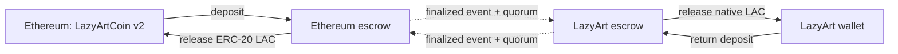

# LazyArt networks and LAC assets

**LazyArt** is the network. **LazyArtCoin (LAC)** is its native currency, used for
transfers, contract execution and staking. A wallet address can be used on more
than one EVM network, but its balances remain separate.

| Asset | Network | Identity | Current use |
| --- | --- | --- | --- |
| Native LazyArtCoin / LAC | LazyArt, chain 20261020 | Native currency; no ERC-20 address | Transfers, fees, staking, faucet and Fun/D |
| LazyingArtCoin / LAC | Ethereum, chain 1 | `0x56E140d1ce7bFf0a7B83E5a778829111f069326E` | Current Ethereum token |
| Legacy LazyArtCoin / LAC | Ethereum, chain 1 | `0xC1eBA98611e9C64684A4aE74d66872FdaFb1cD29` | Earlier token, independently readable |
| LazyArtCoin v2 / LAC | Intended for Ethereum | Not deployed; no contract address | Contract and migration candidate |
| tLACP | Earlier playground, chain 20261018 | ERC-20 on the original playground | Existing playground transfers and bridge |
| wtLACP | Second playground, chain 20261019 | Wrapped counterpart of tLACP | Existing playground return bridge |

The **wtLACP companion belongs to tLACP**. It is not a second form of the native
LAC used by the current LazyArt proof-of-stake network. Fun/D is an application
for funded creator grants, rather than another currency or a network name.

## Moving between LazyArt and Ethereum

The new migration candidate uses one escrow on each network. A deposit locks the
source asset; a quorum-attested release pays the same base-unit quantity from a
prefunded destination reserve. The reverse route uses the same rules. Both assets
use 18 decimals. Neither escrow mints tokens.

The corridor has not been deployed on Ethereum. Its contracts, event verifier and
two-network round-trip test are in this repository. Pair addresses, reserves,
limits and attestors must be specified for an actual deployment. A common ticker
or app account does not make balances transferable by itself.

A gradual migration can move new community activity and app defaults to LazyArt,
reduce new Ethereum-side allocations, and eventually retire outbound deposits.
The candidate preserves inbound claims after that retirement. Existing holders'
Ethereum tokens remain in their wallets until they choose a supported migration;
changing an app label cannot move or destroy them.

## What can be upgraded

The v2 monetary core fixes its issuance envelope at deployment. It has no proxy
that can replace every rule. Delayed governance can change allowed operating
settings, assign finite budgets and publish new versions of separate modules.
Outstanding grants and tasks stay with the contracts that hold their commitments.

The website, wallet interface, node software and module discovery can evolve on
their own release cycles. A change outside the token's existing authority needs a
new module or an explicitly designed token migration.

## Accounts and balances

A shared LazyingArt account is an identity, not a blockchain wallet. Signing in
alone does not prove control of a public address. Wallet signing remains in the
wallet application. Earned community points and purchased app credits also retain
their own ledgers; they are not added to on-chain LAC balances.

[Open LazyArt](https://lac.lazying.art/) ·
[Open the LazyArtCoin app](https://coin.lazying.art/)
